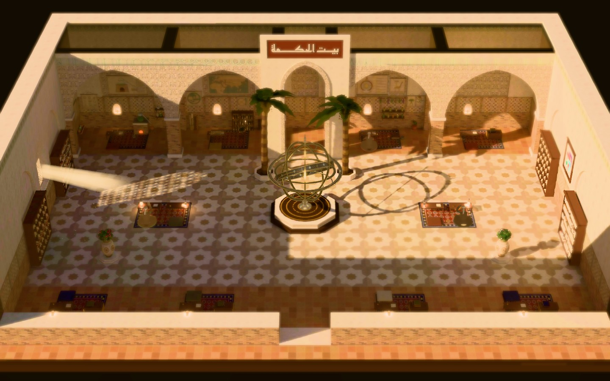
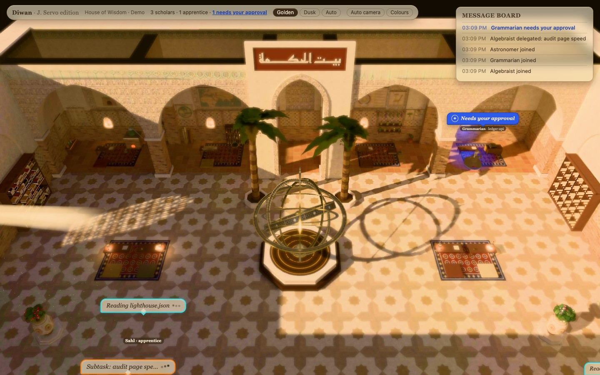

<a href="https://jservo.com">
  <picture>
    <source media="(prefers-color-scheme: dark)" srcset="https://raw.githubusercontent.com/j-servo/.github/main/profile/assets/banner-dark.svg?v=2">
    <source media="(prefers-color-scheme: light)" srcset="https://raw.githubusercontent.com/j-servo/.github/main/profile/assets/banner-light.svg?v=2">
    
  </picture>
</a>

  &nbsp;
  &nbsp;
  &nbsp;
  &nbsp;
  &nbsp;
  &nbsp;
  

 

**J. SERVO** is an applied AI company that designs, builds and operates production AI systems for
startups and mid-sized enterprises across Egypt and the GCC. Our work covers agentic AI, autonomous
workflows, ERP and CRM platforms, and the governance needed to run them safely.

We start from the business, not the model. Every engagement begins with an assessment, is measured
against agreed KPIs, and ships as infrastructure our clients own, with no vendor lock-in.

## What we do

<table>
  <tr>
    <td width="33%" valign="top">
      
      <h4>Agentic AI</h4>
      Multi-agent systems, Web2Agent services and conversational agents across WhatsApp, web and voice, grounded in your own data.
    </td>
    <td width="33%" valign="top">
      
      <h4>Intelligent Automation</h4>
      Autonomous workflows for data entry, compliance checks, document handling, customer service and forecasting.
    </td>
    <td width="33%" valign="top">
      
      <h4>Enterprise Systems</h4>
      Custom ERP, CRM, HRMS, QMS and DMS platforms that bring finance, HR, sales, projects, POS and QA/QC under one roof.
    </td>
  </tr>
  <tr>
    <td width="33%" valign="top">
      
      <h4>Private & On-Prem AI</h4>
      Air-gapped, zero-retention RAG and local inference for regulated industries where data cannot leave the building.
    </td>
    <td width="33%" valign="top">
      
      <h4>Governance & Compliance</h4>
      Company policies (HSE, QA/QC, SOPs), operating templates and document management: the foundation AI runs on.
    </td>
    <td width="33%" valign="top">
      
      <h4>Transformation & Project Controls</h4>
      Process redesign, change management and PMS-driven cost, schedule, risk and quality control.
    </td>
  </tr>
</table>

## Showcase

<picture>
  <source media="(prefers-color-scheme: dark)" srcset="https://raw.githubusercontent.com/j-servo/.github/main/profile/assets/diwan-dark.svg?v=1">
  <source media="(prefers-color-scheme: light)" srcset="https://raw.githubusercontent.com/j-servo/.github/main/profile/assets/diwan-light.svg?v=1">
  
</picture>

**Diwan** turns every Claude Code session on your machine into a scholar in a live 3D diorama of history's
great houses of learning: the **House of Wisdom** in Abbasid Baghdad and the **House of Life** in Ptolemaic Egypt.

<table>
  <tr>
    <td width="33%" valign="top">
      
      <h4>Observe</h4>
      See what each agent is reading, writing, running or searching, in real time.
    </td>
    <td width="33%" valign="top">
      
      <h4>Steer</h4>
      Launch sessions, approve or deny tool calls and send follow-ups, with a full audit trail.
    </td>
    <td width="33%" valign="top">
      
      <h4>Secure by design</h4>
      Loopback-only server, per-run tokens, strict origin checks and secret redaction.
    </td>
  </tr>
</table>

<table>
  <tr>
    <td width="33%" align="center">
      
      The House of Wisdom at golden hour
    </td>
    <td width="33%" align="center">
      
      Live activity above every scholar
    </td>
    <td width="33%" align="center">
      
      The armillary at the heart of the court
    </td>
  </tr>
</table>

  

  
  
  
  
  

## Selected work

Production systems delivered for clients and partners. These are outcomes as reported in our [case studies](https://jservo.com/case-studies/).

<a href="https://jservo.com/case-studies/">
<picture>
  <source media="(prefers-color-scheme: dark)" srcset="https://raw.githubusercontent.com/j-servo/.github/main/profile/assets/sections/cases-dark.svg?v=1">
  <source media="(prefers-color-scheme: light)" srcset="https://raw.githubusercontent.com/j-servo/.github/main/profile/assets/sections/cases-light.svg?v=1">
  
</picture>
</a>

<b>Read the full outcomes</b>

 

| Engagement | Domain | Outcome |
| :--- | :--- | :--- |
| **POJEHAT** | Omnichannel AI support | 70%+ of tier-1 queries automated, with replies in under 1.2 s around the clock |
| **DELTA** | ERP and 3D parametric engineering | 65% shorter drafting cycles; inventory variance under 0.5% |
| **BRICS** | Air-gapped, zero-retention RAG | Full data sovereignty; legal document review 4.5x faster |
| **QWIRVA** | B2B sales automation, with Aghrba | 250K+ leads graded; 3.2x more qualified appointments |
| **SUNDIAL** | Autonomous agent infrastructure | 99.99% uninterrupted overnight multi-agent operation |
| **QuranMath** | Classical Arabic NLP | 98.9% semantic alignment across 50K+ sessions |
| **Masar** | Arabic-first generative AI | 10K+ business emails generated, with RTL formatting intact |

<b>TRUSTED BY</b>

  <a href="https://bluemarinelife.qa"><picture><source media="(prefers-color-scheme: dark)" srcset="https://raw.githubusercontent.com/j-servo/.github/main/profile/assets/sections/client-bml-dark.svg?v=1"><source media="(prefers-color-scheme: light)" srcset="https://raw.githubusercontent.com/j-servo/.github/main/profile/assets/sections/client-bml-light.svg?v=1"></picture></a>
  <a href="https://axleeng.net"><picture><source media="(prefers-color-scheme: dark)" srcset="https://raw.githubusercontent.com/j-servo/.github/main/profile/assets/sections/client-axle-dark.svg?v=1"><source media="(prefers-color-scheme: light)" srcset="https://raw.githubusercontent.com/j-servo/.github/main/profile/assets/sections/client-axle-light.svg?v=1"></picture></a>
  <a href="https://xyz-survey.com"><picture><source media="(prefers-color-scheme: dark)" srcset="https://raw.githubusercontent.com/j-servo/.github/main/profile/assets/sections/client-xyz-dark.svg?v=1"><source media="(prefers-color-scheme: light)" srcset="https://raw.githubusercontent.com/j-servo/.github/main/profile/assets/sections/client-xyz-light.svg?v=1"></picture></a>

## Products

<table>
  <tr>
    <td colspan="2" width="66%" valign="top">
      
      <h4><a href="https://jservo.com/dragonfly-ai-architect/">Dragonfly AI Architect</a></h4>
      A visual, node-based environment for designing, connecting and deploying LLM agents into live workflows, with built-in ROI modelling.
    </td>
    <td width="34%" valign="top">
      
      <h4><a href="https://jservo.com/ai-roi-calculator/">AI ROI Calculator</a></h4>
      Risk-adjusted projections of savings, investment, payback and three-year ROI.
    </td>
  </tr>
  <tr>
    <td width="33%" valign="top">
      
      <h4><a href="https://jservo.com/masar-arabic-email-generator/">Masar</a></h4>
      Arabic-native business email generation.
    </td>
    <td width="33%" valign="top">
      
      <h4><a href="https://jservo.com/image-color-studio/">Image & Color Studio</a></h4>
      In-browser asset conversion and palette extraction powered by vision models.
    </td>
    <td width="34%" valign="top">
      
      <h4>Free AI tools</h4>
      <a href="https://jservo.com/ai-tool-finder/">Tool Finder</a> · <a href="https://jservo.com/ai-comparison-tool/">Comparison</a> · <a href="https://jservo.com/ai-prompt-generator/">Prompt Generator</a>, for teams evaluating and adopting AI.
    </td>
  </tr>
</table>

## How we work

Engagements follow the **[J. SERVO AI Blueprint™](https://jservo.com/ai-transformation-blueprint/)**, a 90-day path from assessment to measurable return.

<a href="https://jservo.com/ai-transformation-blueprint/">
<picture>
  <source media="(prefers-color-scheme: dark)" srcset="https://raw.githubusercontent.com/j-servo/.github/main/profile/assets/sections/blueprint-dark.svg?v=1">
  <source media="(prefers-color-scheme: light)" srcset="https://raw.githubusercontent.com/j-servo/.github/main/profile/assets/sections/blueprint-light.svg?v=1">
  
</picture>
</a>

<picture>
  <source media="(prefers-color-scheme: dark)" srcset="https://raw.githubusercontent.com/j-servo/.github/main/profile/assets/sections/principles-dark.svg?v=1">
  <source media="(prefers-color-scheme: light)" srcset="https://raw.githubusercontent.com/j-servo/.github/main/profile/assets/sections/principles-light.svg?v=1">
  
</picture>

## Technology

<picture>
  <source media="(prefers-color-scheme: dark)" srcset="https://raw.githubusercontent.com/j-servo/.github/main/profile/assets/sections/tech-dark.svg?v=1">
  <source media="(prefers-color-scheme: light)" srcset="https://raw.githubusercontent.com/j-servo/.github/main/profile/assets/sections/tech-light.svg?v=1">
  
</picture>

## Work with us

<a href="https://jservo.com/contact-us/">
<picture>
  <source media="(prefers-color-scheme: dark)" srcset="https://raw.githubusercontent.com/j-servo/.github/main/profile/assets/sections/cta-dark.svg?v=1">
  <source media="(prefers-color-scheme: light)" srcset="https://raw.githubusercontent.com/j-servo/.github/main/profile/assets/sections/cta-light.svg?v=1">
  
</picture>
</a>

  
  
  

 

<picture>
  <source media="(prefers-color-scheme: dark)" srcset="https://raw.githubusercontent.com/j-servo/.github/main/profile/assets/sections/footer-dark.svg?v=1">
  <source media="(prefers-color-scheme: light)" srcset="https://raw.githubusercontent.com/j-servo/.github/main/profile/assets/sections/footer-light.svg?v=1">
  
</picture>

© 2026 J. SERVO LLC · <a href="https://jservo.com/privacy-policy/">Privacy</a> · <a href="https://jservo.com/terms-of-service/">Terms</a> · <a href="https://jservo.com/ai-disclaimer/">AI Disclaimer</a>

